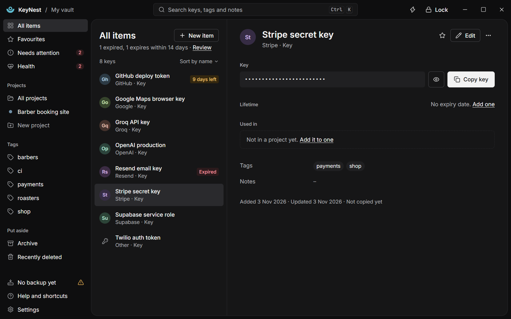
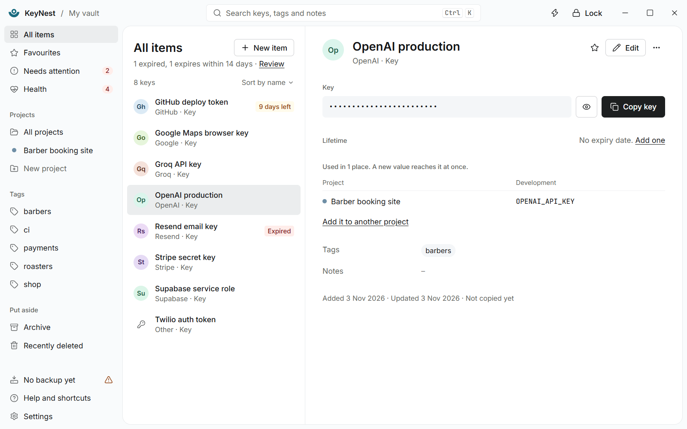
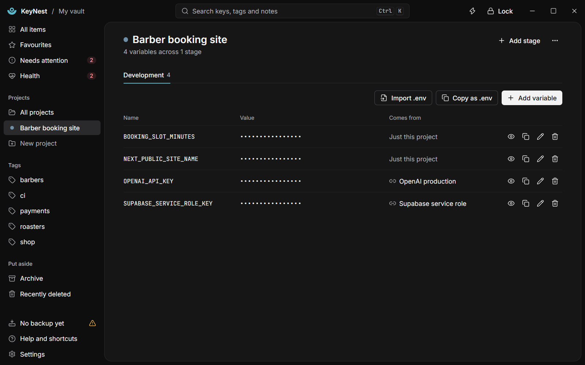
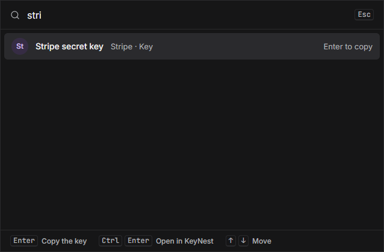
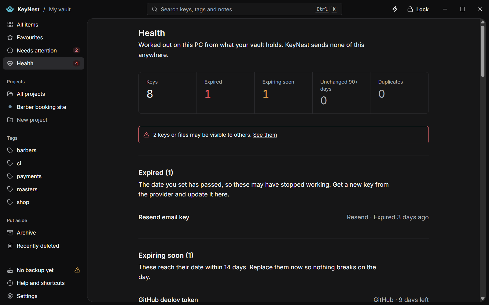
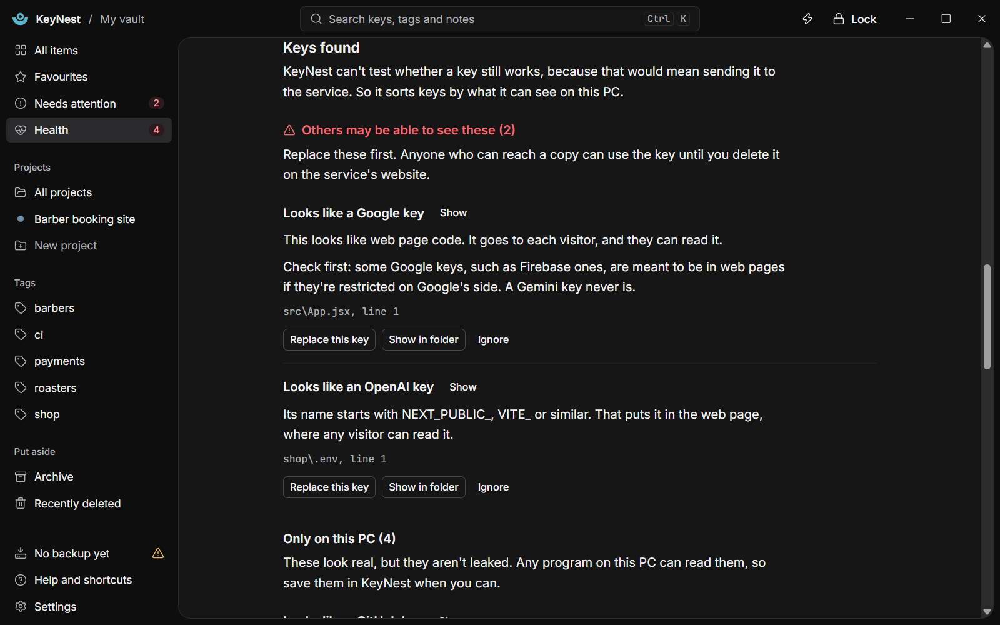
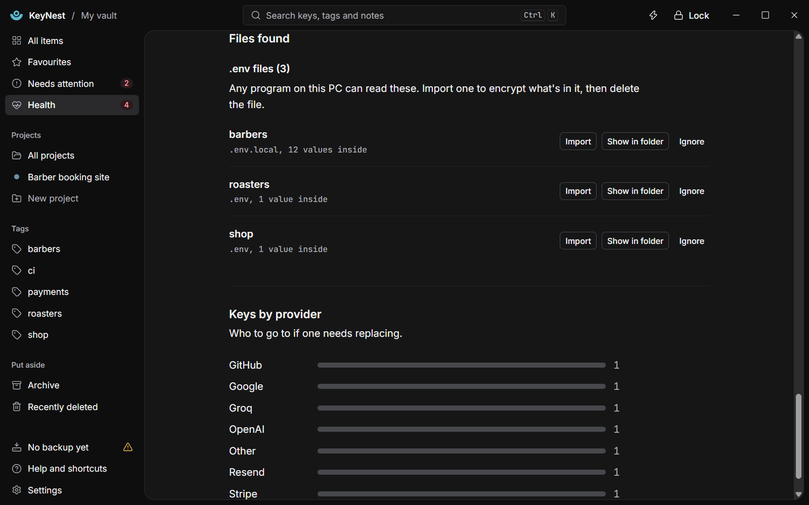
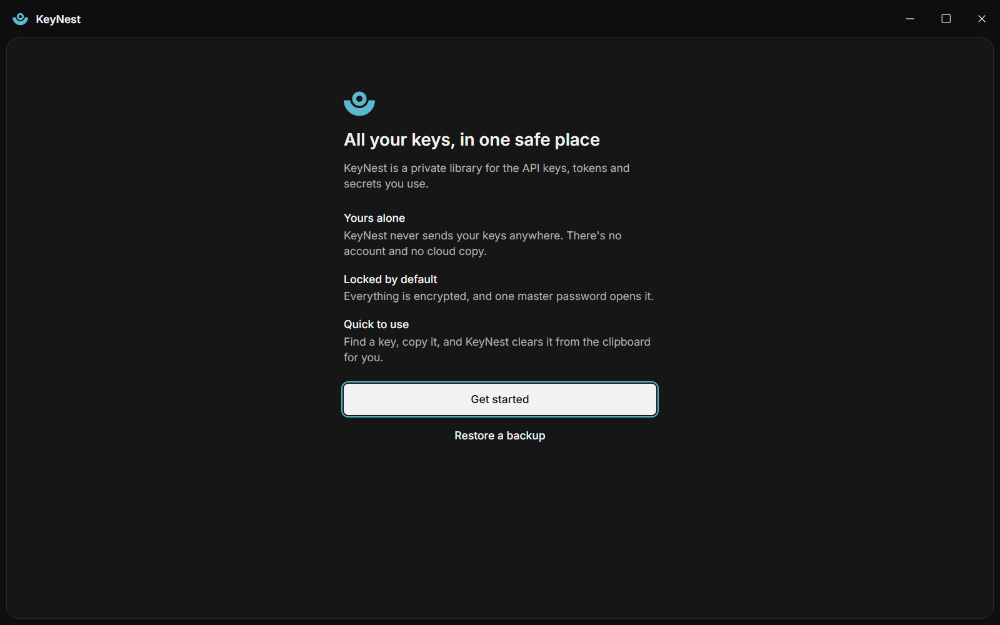

# KeyNest

**Problem:** API keys and secrets end up in plain text in .env files, code and tool folders, where other people can reach them.

**What I built:** A free offline Windows app that keeps them in an encrypted vault and finds loose keys on your PC, sorted by who could reach them.

**Result:** 176 automated tests pass and a source-only security review found no confirmed vulnerability. It is an early preview with no independent review yet. Read the [case study](CASE-STUDY.md).

KeyNest is a private library for the API keys, tokens and secrets you use when you build software. It runs on Windows, keeps everything in an encrypted vault on your own PC, and never sends your keys anywhere. There is no account, no subscription and no cloud copy.

It is made for developers. Coding tools can save a copy of any key you paste into a chat, in plain text in their own folders. KeyNest finds keys left lying around like that, sorts them by who could actually reach them, and helps you move them into the vault.

A portfolio project by Cameron Pittaway. I made the product, design and business decisions.

## Try it

Try KeyNest in your browser: [keynest-demo.pages.dev](https://keynest-demo.pages.dev/). It uses the app's real screens with made-up keys, projects and files. Nothing in it is encrypted, saved or sent anywhere, and reloading the page starts it again, so don't type real keys into it.

## Code

Code: private. This repository is a showcase only: it holds this page, the case study and screenshots, not the source code.

**This is an early preview.** KeyNest has not had an independent security review yet, and it is not code-signed yet. It isn't available to download yet, but you can [try it in your browser](https://keynest-demo.pages.dev/).

## Screenshots

| | |
|---|---|
|  |  |
|  |  |
|  |  |
|  |  |

Every key, project and file in these screenshots is made up.

## Features

- An encrypted vault for API keys, tokens and secrets, with providers, tags, notes, expiry dates and favourites.
- Projects with stages (for example development and production). A variable can point at a saved key, so replacing the key updates every project that uses it. Import a `.env` file, or copy a stage back out as `.env` text.
- Quick Access: a keyboard shortcut opens a small search box over any app. Press Enter to copy a key. KeyNest clears the clipboard again after a set time.
- Health: expired keys, keys expiring soon, keys not changed for a set number of days, and the same key saved twice.
- Look for loose keys: one check reads the folders AI coding tools use, another reads a folder you choose for `.env` files, private SSH keys and keys saved in text or code files.
- Keys found are sorted into three groups: others may be able to see these (for example a key in web page code, or in a file Git sends to an online copy), only on this PC, and probably not real (sample keys from tutorials and test code). One row per key, however many files hold it.
- A step-by-step guide to replacing a leaked key in the safe order, so nothing breaks before the new key is in place.
- Windows Hello unlock, automatic locking, encrypted backups, a recovery code, light and dark themes, and a guided tour with a choice of simple or developer wording.

## How it works

1. Your master password unlocks a random vault key using Argon2id. The vault key is only ever stored wrapped, and locking wipes it from memory.
2. The vault is a SQLCipher database. Each secret inside it is sealed again on its own with XChaCha20-Poly1305, using keys derived with HKDF.
3. The scans only read files, and only when you press a button. They never store a key: they keep where it was found and a keyed fingerprint, so the same key in several files shows as one row. Pressing Show reveals only the start and last 4 characters, for 20 seconds.
4. KeyNest can't tell whether a found key still works without sending it to the service, so it never tests keys. It sorts them by what it can see on the PC instead, and says so on screen.

## Stack

| Part | What is used |
|---|---|
| App shell | Tauri 2.12.5, Rust 1.99.1 |
| Screens | React 19, TypeScript 5.9, Vite 7, Tailwind CSS 4, Radix UI |
| Vault | SQLCipher (through rusqlite 0.41.1), Argon2id, XChaCha20-Poly1305, HKDF-SHA-256 |
| Windows | WebView2, Windows Hello, global shortcut, tray icon |

## Measured results

- 176 automated tests of the vault, crypto, scans, backups and projects pass (3 November 2026).
- Window tests that drive the real app, covering setup, keys, projects, Quick Access, Health, backups and the scans, pass on the production build (1 November 2026).
- On one developer's PC, 96% of the 99,863 files a full user-folder scan would have opened were other people's code, such as installed tool documentation. The scan now leaves those folders out (1 November 2026).
- A source-only security review, quick profile, found no confirmed vulnerability. It raised two leads, and both were fixed with tests (3 November 2026).

## Security and privacy

- KeyNest itself makes no network connections: no analytics, no accounts, no crash reports, no cloud copy. It draws its screens with WebView2, a part of Windows made by Microsoft, and WebView2 can open its own connection to Microsoft.
- The vault lives in a `KeyNest` folder in your Windows user folder. Backups stay encrypted, and open with your master password or your recovery code.
- If you lose your master password and your recovery code, nobody can open the vault, including the maker.
- Not yet done: an independent security review and code signing.

## System requirements

Windows 10 or 11, 64-bit, with WebView2 (built into Windows 11 and most up-to-date Windows 10 PCs).

## Licence

All rights reserved. The source code is not published.

Contact: contact@tarnfieldstudio.com
